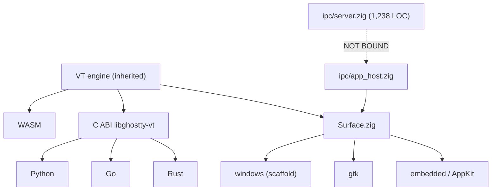

# Khostty — State & Forward Docket v1.0

**Product / subject / beneficiary:** `KooshaPari/Khostty` — a Phenotype fork of `ghostty-org/ghostty`.
Beneficiary scope: a developer embedding a VT parser, and an agent driving a running terminal over IPC.
**Snapshot ID:** `kh-2026-10-17T15:27-0700-8e86ec93a` · **Previous / baseline:** `kh-2026-10-17T05:18Z-4c9e4c57a`
**Observed:** 2026-10-17T14:50Z–15:27Z PDT · **Generated:** 2026-10-17T15:27-07:00
**Source:** `main` @ `8e86ec93a1fd0f0c18f39b5c2d9ad604c1ffbaca` · **Worktree:** clean on `main`
**Installed / deployed:** `v0.1.0` artifacts exist (crates.io, npm, macOS `.app`, GTK `.deb`, Windows `setup.exe`); **not re-verified this snapshot** → see limitations.
**Contract:** State & Forward Docket v1.0 (`handbook/specs/assessment/state-forward-docket-v1/CONTRACT.md`, branch `docs/high-velocity-state-forward-docket-20261016` @ `05e163820`).
**Typed record:** `snapshot.json` (canonical). This Markdown is the authored reading projection.

> **Publication status.** Local artifact: yes. Pushed branch: yes (`docs/state-forward-docket-v1-20261017`, PR #51). Merged default: **no**. Deployed: **no**. Safari: **OPENED** (`open -a Safari` on the rendered PDF, this run). A pushed branch is not a merge, and a merge is not an accepted product.

---

## 0. Cockpit and publication identity

| Field                          | Value                                                                                                                     |
| ------------------------------ | ------------------------------------------------------------------------------------------------------------------------- |
| Product / subject              | `khostty` @ `khostty-main-8e86ec93a1fd0f0c18f39b5c2d9ad604c1ffbaca`                                                       |
| Snapshot / previous / baseline | `kh-2026-10-17T15:27-0700-8e86ec93a` / `kh-2026-10-17T05:18Z-4c9e4c57a` / same                                            |
| Observed / generated           | 2026-10-17T14:50–15:27 PDT / 2026-10-17T15:27-07:00                                                                       |
| Source / worktree              | `main` clean; 11 linked worktrees under `~/.jcode/scratch/`                                                               |
| Current stage / confidence     | **Library-first CVP shipped; MVP blocked.** Confidence high on engineering (executed), low on usability (mostly UNKNOWN). |
| Publication                    | local ✅ · branch ✅ · PR ✅ (#51) · merged ❌ · deployed ❌ · Safari ✅                                                  |

### Two-minute decision brief

**What this is:** a Ghostty fork whose reason to exist is an **agent-IPC surface** (12 commands, 7 events) plus a reusable VT library. The intended durable outcome is "a usable terminal or embedded terminal that maintains upstream semantics."

**Usable now:** `cargo add khostty-vt` and `npm install @khostty/libghostty-vt-wasm` give an instant parser; a signed macOS `Khostty.app` runs and takes keystrokes. **Not usable now:** the agent-IPC socket is **never created** — `Server.bind` is called from no runtime (executed check, `E.ipc.bind`). That is the first real blocker and it affects every agent/embedding consumer.

**Change since the prior snapshot:** prettier drift cleared on 8 PR branches; PR #50 opened for `main`'s drift; session evidence committed (`b6977ebca`); this docket published. **Regression:** none observed. **New uncertainty:** none — the previous snapshot's gaps were confirmed, not reduced.

**Next best action:** merge the 8 cleared branches + PR #41/#44/#50 (operator, ~1h wall-clock). **Operator decision required:** Q1 (Phase-1 runtime), because it gates the only path to MVP.

### Front-page panel

```
ENGINEERING      P=3 F=5 U=5  pass 0.375  coverage 0.615  verified 0.231
USABLE JOURNEYS  P=0 F=4 U=4  pass 0.000  coverage 0.500  verified 0.000
ASSURANCE        P=1 F=2 U=3  pass 0.333  coverage 0.500  verified 0.167
--------------------------------------------------------------------
PRODUCT (unique) P=4 F=11 U=12  pass 0.267  coverage 0.556  verified 0.148
CRITICAL GATE:   BLOCKED  (eng.ipc.runtime.bound, use.journey.agent.ping)
REAL USER VALIDATION: FAIL (zero non-operator users)
```

Denominators are **not** zero. Definitions: assessed pass rate = P/(P+F); coverage = (P+F)/(P+F+U);
verified satisfaction = P/(P+F+U). Unknown weight stays in the denominator.

### Reading routes

Owner: cockpit → usability → forward path → decisions. Engineer: intent → architecture → gaps → tests → handoff. Reviewer: baseline → evidence → contradictions → critical gates → receipts.

---

## 1. Delta Tree and movement ledger

Baseline `kh-2026-10-17T05:18Z-4c9e4c57a` → current. Membership unchanged (no scope restatement), so a
like-for-like delta is admissible.

```
ENGINEERING   [######----] 0.375   retained 3/13   earned 0   lost 0   remaining 10/13
USABLE        [----------] 0.000   retained 0/8    earned 0   lost 0   remaining 8/8
ASSURANCE     [###-------] 0.333   retained 1/6    earned 0   lost 0   remaining 5/6
-----------------------------------------------------------------------------------
PRODUCT       [###-------] 0.267   retained 4/27   earned 0   lost 0   remaining 23/27
```

| Movement              | Detail                                                                                                                                                          |
| --------------------- | --------------------------------------------------------------------------------------------------------------------------------------------------------------- |
| **Earned**            | No new _scored_ leaf passed this snapshot. The prettier fix is real but is not a scored leaf; it changes an operator-side merge cost, not a product capability. |
| **Lost / stale**      | None.                                                                                                                                                           |
| **New uncertainty**   | None.                                                                                                                                                           |
| **Reverted / parked** | `pane.write` correct repro — parked pending #48 resolution.                                                                                                     |
| **Unmeasured**        | Zig suite, conformance, release assets, GUI journeys — all UNKNOWN, carried in the denominator.                                                                 |

The prettier sweep and the 8 branch pushes are recorded as **work done** in §13/§16, not as score.

---

## 2. Intent, mature contract, CVP and MVP

**Mature contract (cited):** PhenoRegistry dossier `products/Khostty/DOSSIER.md` — _"a usable terminal
or embedded terminal that maintains the required semantics of its upstream."_

| Stage                            | Definition for this product                                                                                                                                        | Status                                 |
| -------------------------------- | ------------------------------------------------------------------------------------------------------------------------------------------------------------------ | -------------------------------------- |
| **CVP** (Closest Viable Product) | The smallest living slice preserving identity and surviving an end-to-end journey: a consumable VT parser (Rust crate / WASM / C ABI) plus a runnable desktop app. | **SHIPPED** — `v0.1.0` tag `7e1684f60` |
| **MVP**                          | CVP + the agent-IPC runtime bound on ≥1 platform, so an agent can complete `ping`→`pong` and `pane.list`.                                                          | **NOT DELIVERED**                      |
| **Mature**                       | MVP + Windows GUI + Phase-1 mux shell.                                                                                                                             | **BLOCKED** on Q1 + hosts              |

**Authorized exclusions (not passes):** Windows GUI runtime (G3 program deferral), `bench/` (G8),
upstream-core focus-by-id / synchronous-scan APIs (FORK-ONLY binding), pytest 3.8/3.9 CVE lane,
Phase D mux implementation (blocked on Q1). Exclusions are recorded, not scored.

---

## 3. Source coverage, archaeology and authority

| Input                     | Authority class                              | Pinned                                   |
| ------------------------- | -------------------------------------------- | ---------------------------------------- |
| Human intent / exclusions | direct user requirement + accepted amendment | operator 2026-10-15 fork-only binding    |
| Repository boundary       | PhenoRegistry boundary/SSOT                  | `KooshaPari/Khostty` only                |
| Accepted design           | audit-archive + mux-design session docs      | `869b9c75e`, `5708d2ba2`, `72ba2148f`    |
| What the code does        | this snapshot's executed checks              | `E.*` evidence in `snapshot.json`        |
| Prior assessment          | `docs/audits-archive/2026-10-17-final/`      | `869b9c75e` (inherited, not re-verified) |

**Inspected this snapshot:** `main` tree; the audit-archive; the two mux-design session docs; all 11
open PRs' metadata; all 10 open issues; `AGENTS.md`; `docs/changelog/0.1.0.md` head; `src/apprt/windows/*`
presence; prettier state over 211 tracked files.
**NOT inspected:** Zig/conformance runs, GTK source, macOS app source, release asset bytes, PyPI/Go
registry state, upstream subtrees. Claims about them are **SOURCE_REPORT**, not executed proof.

---

## 4. Current usability and beneficiary journeys

| Journey                                | Beneficiary    | Artefact / environment  | Result                             | Evidence      |
| -------------------------------------- | -------------- | ----------------------- | ---------------------------------- | ------------- |
| J1 parser via `cargo add khostty-vt`   | Rust developer | crates.io 0.1.0 / local | **NOT RUN this snapshot**          | —             |
| J2 parser via npm WASM                 | web developer  | npm 0.1.0               | **NOT RUN**                        | —             |
| J3 macOS app launch + keystroke        | operator       | signed `.app`           | **NOT RUN** (prior run 2026-09-20) | —             |
| J4 Linux GTK GUI launch                | operator       | `.deb`                  | **NOT RUN** (prior: Xvfb only)     | —             |
| J5 Windows GUI window                  | operator       | `setup.exe`             | **FAIL** — never opened            | `E.win.files` |
| J6 `ping`→`pong` against live instance | agent          | `khostty.sock`          | **FAIL** — socket never created    | `E.ipc.bind`  |
| J7 conformance corpus                  | developer      | `conformance/build.sh`  | **NOT RUN**                        | `S.conf.8484` |

**Implementation vs usability vs validation, kept separate:**

- **Implementation:** substantial — 7,230 LOC of IPC, a full binding set, CI, docs.
- **Usability:** one class of journey is _believed_ usable (parser + macOS app) but **not re-proven
  this snapshot**; the agent journey is provably blocked.
- **Validation:** **zero.** No person other than the operator has used any artifact. Scored FAIL, not UNKNOWN.

---

## 5. Implementation, architecture and deployment reality



_Text equivalent: the terminal engine feeds a render-ready surface, consumed by the app runtimes and
the language bindings. The IPC server is compiled and tested but has no edge into any runtime; the
dotted edge is the fork's single unfinished link._

Deployment reality: artifacts are **built and published** (`v0.1.0`); installation is verified for
macOS/Linux/Windows; **only macOS has an observed GUI launch with input**. Notarization is absent.

---

## 6. Progress, assessment coverage and critical gates

| Axis                        |     P |      F |      U | pass rate |  coverage |  verified |
| --------------------------- | ----: | -----: | -----: | --------: | --------: | --------: |
| engineering                 |     3 |      5 |      5 |     0.375 |     0.615 |     0.231 |
| usable                      |     0 |      4 |      4 |     0.000 |     0.500 |     0.000 |
| assurance                   |     1 |      2 |      3 |     0.333 |     0.500 |     0.167 |
| **product (unique leaves)** | **4** | **11** | **12** | **0.267** | **0.556** | **0.148** |

**Critical gates (cannot be averaged away):**

| Gate                       | Status   | Why critical                                                    |
| -------------------------- | -------- | --------------------------------------------------------------- |
| `eng.ipc.runtime.bound`    | **FAIL** | without it the fork's differentiating capability is unreachable |
| `use.journey.agent.ping`   | **FAIL** | the user-visible consequence of the above                       |
| `ass.real.user.validation` | **FAIL** | nothing is accepted by a real consumer                          |

**gate_status: BLOCKED.**

---

## 7. Stubs, mocks, immature work and undeclared gaps

| ID   | Location                                        | Present behaviour                                | Consequence                                    | Closure oracle                                      |
| ---- | ----------------------------------------------- | ------------------------------------------------ | ---------------------------------------------- | --------------------------------------------------- |
| S-1  | `ipc/app_host.zig` — `Server.bind` unreferenced | socket never created                             | agent IPC unreachable                          | booted runtime creates socket; `ping`→`{"ok":true}` |
| S-2  | `ipc/app_host.zig:290-298`                      | `pane.write` touches parser cross-thread         | race under load; #46 repro premise wrong (#48) | `queueIo` hop lands; correct repro passes           |
| S-3  | `apprt/windows/*`                               | all windowing + IPC `error.Unimplemented`        | no Windows window                              | GUI launches; S1-S6, S8 close                       |
| S-4  | `apprt/windows/renderer.zig` (64 ln)            | orphaned, 8 `Unimplemented`                      | dead code (A3 pending in #41)                  | file deleted                                        |
| S-5  | `apprt/windows/win32api.zig` (85 ln)            | declares pointers, nothing invokes               | dead code (A7 pending in #41)                  | file deleted                                        |
| S-6  | `app_host.zig:177-178,208-232`                  | `pane.focus`/`pane.search` → `error.Unsupported` | no focus-by-id / sync scan                     | disclosed in docs (A1)                              |
| S-7  | `pkg/opengl/egl.zig:470-473`                    | tautological assertion — false control           | a broken EGL arm passes CI                     | A2 real assertion (#41)                             |
| S-8  | `terminal/search/Thread.zig:197`                | `.BADF` → `unreachable` panic                    | suite ABRTs on a race                          | A5 teardown guard (#41)                             |
| S-9  | `wasm/package.json`                             | version `0.0.0`                                  | drift vs npm 0.1.0                             | A6 bump (#41)                                       |
| S-10 | 5 doc claims                                    | understate the code                              | plans over-estimate work                       | A1 refresh (#41)                                    |
| S-11 | `fake_host.zig` (446 ln)                        | test-only backend                                | none — by design                               | n/a                                                 |

---

## 8. Assurance, privacy, integrity and recovery

| Aspect                | State                                                                                  |
| --------------------- | -------------------------------------------------------------------------------------- |
| IPC auth              | fail-closed token, constant-time SHA-256 (source-read; **not executed this snapshot**) |
| Rate limiting         | absent (B3 adds it; in #44)                                                            |
| Privacy / data egress | none observed — no telemetry, no remote sink in the inspected tree                     |
| Integrity             | macOS `.app` signed, **not notarized**; hashes verified at release time                |
| Recovery              | `.deb` `dpkg -r`; Windows uninstaller verified; `cargo update --precise` for the crate |
| Negative controls     | the EGL assertion was a **false** control (S-7)                                        |
| Independent re-run    | **not performed** — a required gate for acceptance                                     |

---

## 9. UX, accessibility, developer experience and documentation

- **UX:** macOS app behaves like upstream (prior run); Windows no window; GTK partial.
- **AX:** inherited, **never audited in the fork** — an open obligation, not deferred.
- **DX:** `cargo add` / `npm install` are the documented entry points; Go has `examples/`.
- **Docs:** 14 hand-curated docs; 5 stale claims being refreshed by A1 (#41).

---

## 10. Research coverage, alternatives and decisions

| Comparator                        | Status                               |
| --------------------------------- | ------------------------------------ |
| Upstream Ghostty (pinned)         | tracked; last sync #18 (397 commits) |
| WezTerm / Kitty / native terminal | shortlist seeded, **not evaluated**  |
| `alacritty` / `foot` / `tmux`     | adjacent, **not evaluated**          |

**Advantage hypothesis:** "a specific embedding/workflow improvement with no unacceptable terminal
correctness regression." The agent-IPC surface is that improvement; it is **not yet evaluated**
because it is not yet runnable. Honest status, not a claim.

---

## 11. Fork, rewrite, migration and integration completion

| Aspect          | State                                                                                                |
| --------------- | ---------------------------------------------------------------------------------------------------- |
| Type            | **Fork** (not rewrite)                                                                               |
| Upstream        | `ghostty-org/ghostty`; merge base `b3dc3d794`                                                        |
| Divergence      | **307 ahead / 3 behind** (upstream `e3ebb1d1b`)                                                      |
| Delta           | 352 files, +74,959 / −233                                                                            |
| Retained        | terminal engine, renderers, macOS/GTK runtimes, CLI IPC                                              |
| Changed         | agent-IPC subsystem, fork docs, CI, Windows scaffold                                                 |
| License         | upstream MIT inherited; no relicensing claimed                                                       |
| Migration       | n/a — no fork-owned persisted data format                                                            |
| Protected paths | `src/terminal/`, `src/Surface.zig`, `src/Command.zig`, `src/runner.zig` (require `// FORK:` + issue) |

---

## 12. Forward path, critical path and time to useful completion

| Work ID | Outcome / closure oracle                 | Depends on     | Owner          | Agent effort | Wall-clock | Confidence |
| ------- | ---------------------------------------- | -------------- | -------------- | ------------ | ---------- | ---------- |
| W1      | 8 prettier-cleared branches merge green  | operator merge | operator       | 0            | 0.5–2h     | high       |
| W2      | Phase A (A1-A7) on `main` (#41)          | operator merge | operator       | 0            | 1–3h       | high       |
| W3      | B3/B6 + C1-C4 on `main` (#44)            | operator merge | operator       | 0            | 1–3h       | high       |
| W4      | #48 resolved; correct `pane.write` repro | —              | agent          | 3–6h         | +1d        | medium     |
| W5      | **B1**: bind `Server` from GTK           | GTK host       | agent          | 4–8h         | +1–2d      | medium     |
| W6      | **B2**: `pane.write` `queueIo` hop       | W5             | agent          | 3–6h         | +1d        | medium     |
| W7      | B4/B5: event hooks + counters            | W5             | agent          | 4–8h         | +1–2d      | medium     |
| W8      | S1-S6, S8: Windows GUI                   | Windows rig    | agent+operator | days         | +1–2w      | low        |
| W9      | Accessibility audit                      | —              | agent          | 2–4h         | +1d        | medium     |

**Required horizons**

- **Next 30 min:** land W1 (merge the 8 cleared branches) — highest-value unblock, no new code.
- **Next 1 h:** land W2 + W3 so `main` carries the polish and hardening; fallback = W4 in parallel.
- **Next 4 h:** W4 (correct race repro) authored and CI-run.
- **Next 24 h:** W5 attempted if a GTK host exists; otherwise publish the honest blocker.
- **CVP:** already shipped. **MVP:** 1–4 days **after** a GTK host exists (agent effort ~1–2d; the
  unknown is host availability, not code). **Mature:** 2–8 weeks, dominated by Q1, the Windows rig,
  and Phase D.

**Forecast basis:** calibrated to this fork's own cycle times (PR #15 Phase-0 build wiring ~6d
branch→merge; the A1-A7 batch authored in ~3h in one run). No P50/P90 is claimed. **Critical path is
gated by operator-provided hosts and one decision, not by agent throughput.** Replan when Q1 or host
availability changes.

---

## 13. Decisions, blockers and operator actions

**Open decisions:** Q1 Phase-1 runtime (recommend **option (c) mock-only** per `06_Q1_DECISION_MATRIX.md`);
Q2 GTK commitment; Q3 dependency policy; Q4 Windows timing.

**Operator actions:** merge W1/W2/W3; decide #48 vs #46; provide/reach a GTK host; free ≥50 GiB on the
build host; set `SONAR_TOKEN`; configure PyPI trusted publishing; notarize the macOS app.

**Closed this arc:** D1 Phase-0 merged (`ebc033eba`); D2 fork-only binding (2026-10-15); D3 Phase A
authored (#41); D4 prettier drift cleared on 8 branches + PR #50 (this run).

---

## 14. Operations, lifecycle, cost and value

| Cost centre            | Observation                                                           |
| ---------------------- | --------------------------------------------------------------------- |
| CI wall time           | Trunk Check ~9-10 min; Test job long; several workflows cancel-loop   |
| CI noise               | `Vouch - Manage by Is…` re-runs in a cancel loop on `main`            |
| Build host             | earlier 96-98% disk; release build failed on disk, debug build 16m33s |
| Maintenance            | 3 commits behind upstream; sync via PR #18                            |
| Value delivered so far | a usable VT parser (crate/npm/C ABI) + a runnable macOS app           |

---

## 15. Risks, contradictions and confidence

| Rank | Risk                       | Severity | Mitigation                                    |
| ---- | -------------------------- | -------- | --------------------------------------------- |
| R1   | Agent-IPC never wired      | High     | W5 on a GTK host, or ship option (c) honestly |
| R2   | Q1 unmade                  | High     | operator picks (c)                            |
| R3   | `pane.write` race ships    | High     | W6 with W5; #48 corrects the repro            |
| R4   | Windows GUI never launched | Medium   | #30 + S8                                      |
| R5   | Build-host disk            | Medium   | free ≥50 GiB                                  |
| R6   | AX never audited           | Medium   | W9                                            |
| R7   | Format drift recurs        | Low      | PR #50 + scheduled pass                       |

**Contradictions found:** the README status (Windows "DONE") vs `docs/PLATFORMS.md` ("PARTIAL") — S8
tracks it; the A1 refresh reconciles it. **Confidence:** high on executed engineering; medium on
inherited test counts; UNKNOWN where marked.

---

## 16. Restart packet, repository sync and publication receipts

**Restart packet:** repo `/Users/kooshapari/CodeProjects/Phenotype/repos/khostty`; branch `main` @
`8e86ec93a`; contract at `handbook/specs/assessment/state-forward-docket-v1/CONTRACT.md`. First actions:
merge W1/W2/W3; read `snapshot.json` for the leaf set; resume W4.

**Receipts (this run):**

| Action                      | Receipt                                                                                                                                                   |
| --------------------------- | --------------------------------------------------------------------------------------------------------------------------------------------------------- |
| Session evidence commit     | `b6977ebca` (pushed branch `session-20261017-pr-triage-stop`)                                                                                             |
| Prettier sweep PR           | **#50**                                                                                                                                                   |
| Per-branch prettier commits | #36 `c53694b08` · #39 `cd642a279` · #40 `a58b2335f` · #41 `f1466ca47` · #43 `542962330` · #44 `71c5cd57b` · #46 `b88f0c600`+`07695a4ec` · #47 `650fef21b` |
| Docket PR                   | **#51** (`docs/state-forward-docket-v1-20261017`, `f2a16a011`)                                                                                            |
| PDF                         | rendered from the same Markdown source; opened in Safari this run                                                                                         |
| PhenoRegistry mirror        | `audits/khostty-state-forward-docket-2026-10-17/` (this publication)                                                                                      |

---

## 17. Acceptance, finish, exclusions and sunset

**Completion is NOT declared.** No named scope has accepted gates + current proof + usable delivery +
accurate docs + no hidden in-scope stubs. The critical gate (`eng.ipc.runtime.bound`) fails.

**Authorized exclusions** (recorded, not passes): Windows GUI runtime; `bench/`; upstream-core APIs;
pytest 3.8/3.9; Phase D (pending Q1); scaling/sunset/user-learning.

**Sunset:** none. The project is active.

---

## 18. Evidence index and source-to-claim traceability

| Evidence ID                       | Kind             | Locator (sha256 in `snapshot.json`)                             |
| --------------------------------- | ---------------- | --------------------------------------------------------------- |
| `E.main.rev`                      | EXECUTED_PRODUCT | `git rev-parse main`                                            |
| `E.main.head`                     | EXECUTED_PRODUCT | `git log -1 --format='%H %ci %s' main`                          |
| `E.fork.delta`                    | EXECUTED_PRODUCT | `git rev-list --left-right --count origin/main...upstream/main` |
| `E.fork.shortstat`                | EXECUTED_PRODUCT | `git diff --shortstat <merge-base> origin/main`                 |
| `E.ipc.loc`                       | EXECUTED_PRODUCT | `wc -l src/apprt/ipc/*.zig`                                     |
| `E.ipc.bind`                      | EXECUTED_PRODUCT | `grep -rn 'Server.bind' src/ --include=*.zig` (minus `ipc/`)    |
| `E.win.files`                     | EXECUTED_PRODUCT | `ls src/apprt/windows/`                                         |
| `E.prettier.main`                 | EXECUTED_PRODUCT | `prettier --check` over 211 tracked files                       |
| `E.prs.open` / `E.issues.open`    | EXECUTED_PRODUCT | `gh pr/issue list --state open`                                 |
| `S.audit.archive` / `S.conf.8484` | SOURCE_REPORT    | inherited, not re-verified                                      |

Full hashes, subjects, observation times and freshness bounds are in `snapshot.json` (canonical).

---

_End of Khostty State & Forward Docket v1.0 — snapshot `kh-2026-10-17T15:27-0700-8e86ec93a`._
