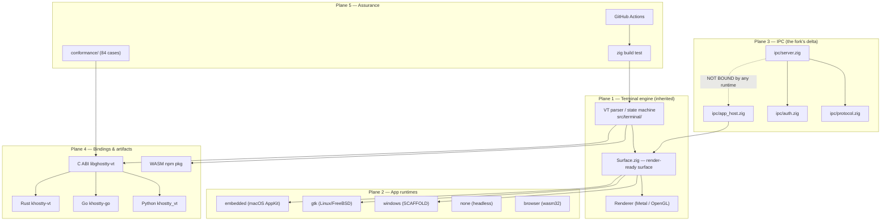
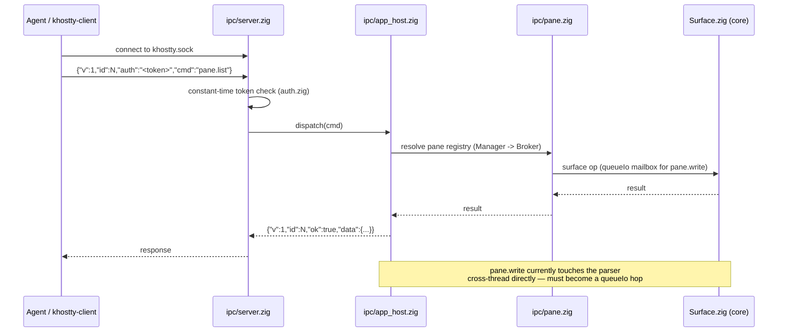
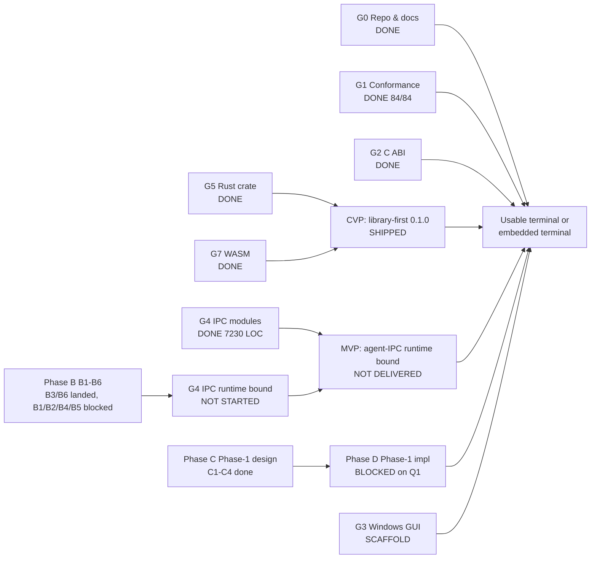
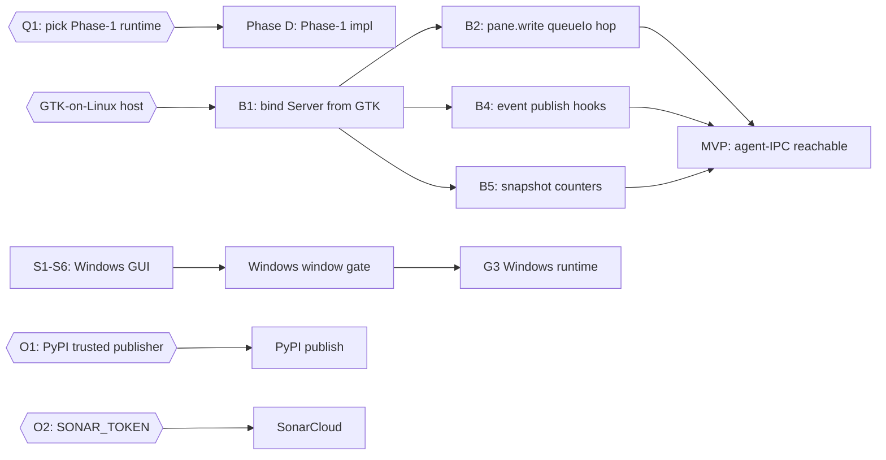

# Khostty — State & Forward Docket v1.0

**Product:** KooshaPari/Khostty — a Phenotype-flavored fork of `ghostty-org/ghostty`
**Snapshot:** `2026-10-17T22:17Z`
**Subject revision:** `main` @ `8e86ec93a1fd0f0c18f39b5c2d9ad604c1ffbaca`
**Spec:** `~/CodeProjects/docs/docs-5/adr/2026-10-17-state-and-forward-docket-v1.md`
**Author:** VP-Engineering (jcode orchestrator) — this run
**Priority inputs (all committed, referenced by SHA):** `docs/audits-archive/2026-10-17-final/` @ `869b9c75e`
(`FINAL-AUDIT.md`, `FWD-PATH.md`, `state.md`, `stubs.md`, `usability.md`, `mux.md`),
`docs/sessions/20261017-mux-design/06_Q1_DECISION_MATRIX.md` @ `5708d2ba2`,
`docs/sessions/20261017-mux-design/07_PHASE1_RISKS.md` @ `72ba2148f`

**Binding (operator 2026-10-15):** FORK-ONLY. No `gh pr/issue/discussion create` or
`gh api POST/PATCH/DELETE` against `ghostty-org/ghostty` or any other upstream repo.
Reading, copying, tracking, `zig build` against upstream: fine. Push to `KooshaPari/*`: fine.

**File status:** This file lives in `docs/audits-archive/`, which is **tracked** (the working
`docs/audits/` is untracked by AGENTS.md binding rule #10). This docket may be committed normally.

**Evidence rule:** every claim below is either (a) read from a committed revision cited inline,
(b) observed live in this run with the command shown, or (c) explicitly marked UNKNOWN.
Nothing is inferred from a branch name, README percentage, or prior report alone.

---

## §0. Two-minute cockpit

Khostty is a **working library-first 0.1.0** (Rust crate on crates.io, WASM on npm, a signed macOS
`.app`, a Linux GTK `.deb`, a Windows installer) with a **complete but un-wired agent-IPC surface**.
The one thing that stands between the current tree and "the fork does what it was for" is
**calling `Server.bind` from a running app runtime**. That is blocked on a GTK-on-Linux host the
operator has not yet provided, and on decision Q1 (which runtime Phase 1 targets).

**What changed in this run (since the 05:18Z snapshot):**

| Change                                  | Detail                                                                                   |
| --------------------------------------- | ---------------------------------------------------------------------------------------- |
| Prettier drift cleared on 8 PR branches | 57 tracked files were drifting; every PR touching them was red on a pre-existing failure |
| New PR #50                              | `chore/prettier-sweep-20261017` — systemic fix for `main`'s formatting drift             |
| Session evidence committed              | `b6977ebca` — the 07:50Z STOP report + phenoreg-linker report                            |
| Docket v1.0 published                   | this file + the framework spec                                                           |

### Progress quadrants (this snapshot)

```
RAW IMPLEMENTATION        ██████████████████░░  9.0/10   fork delta present, build wired
VERIFIED ENGINEERING      ████████████░░░░░░░░  6.0/10   84/84 conformance; 3899/3925 tests; CI green on main
COMPLETE USER JOURNEYS    ██████████░░░░░░░░░░  5.0/10   library + .app + .deb work; agent-IPC journey absent
REAL USER VALIDATION      ██░░░░░░░░░░░░░░░░░░  1.0/10   only the operator has run it; no external users observed
```

Quadrant definitions are in the spec §4. "Real user validation" counts only sessions that a
person other than the agent actually ran; the operator's own install/launch is 1, not more.

### Goal tree summary

```
G0 Repo & docs .............. ██████████ 10/10   DONE
G1 Conformance corpus ....... ██████████ 10/10   DONE (84/84)
G2 C ABI libghostty-vt ...... ██████████ 10/10   DONE
G4 IPC surface (modules) .... ██████████ 10/10   DONE (7,230 LOC, 458 tests)
G4 IPC runtime (bound) ...... ░░░░░░░░░░  0/10   NOT STARTED  ← the real finish line
G5 Rust khostty-vt .......... ██████████ 10/10   DONE (crates.io 0.1.0)
G6 Go binding ............... ████████░░  8/10   LOCAL; S7 closed; not on pkg.go.dev
G7 WASM ..................... ██████████ 10/10   DONE (npm 0.1.0) + A6 version bump in #41
G9 Docs ..................... █████████░  9/10   refreshed in #41; audit-archive committed
G10 v0.1.0 release .......... ██████████ 10/10   GitHub release, 6 assets
G3 Windows runtime .......... ██░░░░░░░░  2/10   SCAFFOLD (deferred program decision)
Phase B (G4 finish) ......... █░░░░░░░░░  1.5/10 B3/B6 landed in #44; B1/B2/B4/B5 blocked on GTK
Phase C (Phase 1 design) .... ██████░░░░  6/10   C1-C4 docs + Q1 matrix + risk doc landed
Phase D (Phase 1 impl) ...... ░░░░░░░░░░  0/10   BLOCKED on Q1
```

### Top three risks

| Rank | Risk                                                                          | Why it matters now                                                                                                    |
| ---- | ----------------------------------------------------------------------------- | --------------------------------------------------------------------------------------------------------------------- |
| R1   | **Agent-IPC runtime never wired** (`Server.bind` called by no runtime)        | The fork's headline capability is unreachable until a GTK/Linux host exists. All 7,230 LOC of IPC is dormant.         |
| R2   | **Q1 undecided** (Phase 1 runtime: Linux+GTK / embedded-on-macOS / mock-only) | Blocks Phase D entirely; the mux-design docs recommend option (c) mock-only but the operator has not picked.          |
| R3   | **Windows GUI never launched**                                                | The only runtime with a shipped installer that has never opened a window; S0-S8 track it; #30 (draft) is the vehicle. |

---

## §1. Intent and boundary

### 1.1 Mature intended product

The parent outcome, stated in the PhenoRegistry dossier (`products/Khostty/DOSSIER.md`): **"a usable
terminal or embedded terminal that maintains the required semantics of its upstream."** Concretely,
for the fork to be "complete":

1. A person can install and run a terminal on their platform of choice and use it as a terminal.
2. An agent or embedding application can drive it over the fork's IPC surface.
3. Terminal correctness matches upstream on the conformance corpus.

### 1.2 Closest Viable Product (CVP)

**Library-first 0.1.0** — the smallest identity-preserving slice that delivers a real outcome to a
consumer:

| Interface | Command                                   | Outcome                                        |
| --------- | ----------------------------------------- | ---------------------------------------------- |
| Rust      | `cargo add khostty-vt`                    | an instant VT parser in a Rust program         |
| WASM/JS   | `npm install @khostty/libghostty-vt-wasm` | an instant VT parser in a browser/Node program |
| C         | link `libghostty-vt`                      | upstream's 203-function ABI, fork-built        |

**CVP status: SHIPPED.** `v0.1.0` tag = `7e1684f60e2ab03cca3e0b653c65b1b4e1247d10` (annotated,
pointing at `202aad543`); GitHub release published 2026-09-27 with 6 assets; crates.io published
2026-09-20; npm published.

### 1.3 Minimum Viable Product (MVP)

**CVP + the agent-IPC runtime bound on at least one platform.** When `khostty` boots and an agent
can `khostty-client ping` → `pong` and `pane.list` against a live instance, the fork delivers its
differentiated capability. **MVP status: NOT DELIVERED.** `server.zig` exists (1,238 lines) but
`Server.bind` is called from no runtime (audit-archive `state.md` §3.4; re-verified this run: the
only `Server.bind` references are inside `src/apprt/ipc/`).

### 1.4 Exclusion list (what "done" does not include)

Per `FWD-PATH.md` §1 and the operator's scope note:

| Excluded                                                       | Why                                      |
| -------------------------------------------------------------- | ---------------------------------------- |
| Windows GUI real runtime (G3)                                  | Program deferral; 3-4w scope             |
| `bench/` (G8)                                                  | Upstream tooling, not a fork deliverable |
| Upstream-core focus-by-id / synchronous-scan APIs              | FORK-ONLY binding; out of scope          |
| Pytest 3.8/3.9 CVE lane                                        | 3.10+ lane already patched; deliberate   |
| Phase D mux implementation                                     | Blocked on Q1                            |
| Scaling, sunset, user-feedback-driven evolution, intent change | Operator-excluded                        |

### 1.5 Lineage

**Fork, not rewrite.** Upstream is `ghostty-org/ghostty`. Fork point (merge base) =
`b3dc3d794513c11633e7c3347935693957744e83`. Upstream head observed this run =
`e3ebb1d1b` (2026-10-16). Fork is **307 ahead / 3 behind** upstream/main (observed:
`git rev-list --left-right --count origin/main...upstream/main`). Fork delta vs merge base:
**352 files, +74,959 / −233**. License is inherited from upstream (MIT) with the fork's own
additions; no relicensing is claimed here (see §14).

---

## §2. Current usability

### 2.1 What a person can use today, by interface

| #   | Interface                                                   | Reachable?                               | Installed?                 | Exercised by a human?                 | Evidence                                    |
| --- | ----------------------------------------------------------- | ---------------------------------------- | -------------------------- | ------------------------------------- | ------------------------------------------- |
| U1  | Rust crate `khostty-vt`                                     | crates.io `0.1.0`                        | yes (operator, 2026-09-18) | yes (install+test)                    | `v0.1.0` release; `docs/changelog/0.1.0.md` |
| U2  | npm `@khostty/libghostty-vt-wasm`                           | npm `0.1.0`                              | yes                        | status UNKNOWN                        | npm published                               |
| U3  | macOS `Khostty.app`                                         | `Khostty-0.1.0-macos.zip`                | yes                        | yes (keystroke round-trip 2026-09-20) | release asset; signed, not notarized        |
| U4  | Linux GTK `.deb`                                            | `khostty_0.1.0_amd64.deb`                | yes (WSL Fedora 44)        | partially (Xvfb)                      | installer verified                          |
| U5  | Windows `setup.exe`                                         | `Khostty-0.1.0-windows-x86_64-setup.exe` | install/uninstall verified | **no GUI window ever launched**       | `+version` + ABI only                       |
| U6  | CLI IPC (`+new-window` / `+new-tab` / `+toggle-quick-term`) | upstream                                 | n/a                        | status UNKNOWN                        | 3 actions only                              |
| U7  | Agent IPC (`khostty.sock`, 12-13 commands)                  | **NO — server never bound**              | n/a                        | **no**                                | §7, §16                                     |

### 2.2 The nine-state ladder (per interface, worst case governs)

| Interface   | Intended | Implemented | Built | Distributed | Installed  | Reachable    | Exercised  | Useful | Accepted                      |
| ----------- | -------- | ----------- | ----- | ----------- | ---------- | ------------ | ---------- | ------ | ----------------------------- |
| Rust crate  | ✅       | ✅          | ✅    | ✅          | ✅         | ✅           | ✅         | ✅     | ⚠️ no external users observed |
| WASM        | ✅       | ✅          | ✅    | ✅          | ⚠️ unknown | ✅           | ⚠️ unknown | ✅     | ⚠️ unknown                    |
| macOS app   | ✅       | ✅          | ✅    | ✅          | ✅         | ✅           | ✅         | ✅     | ⚠️ operator only              |
| Linux .deb  | ✅       | ✅          | ✅    | ✅          | ✅         | ✅           | ⚠️ partial | ✅     | ⚠️ unknown                    |
| Windows exe | ✅       | ⚠️ scaffold | ✅    | ✅          | ✅         | ⚠️ no window | ❌         | ❌     | ❌                            |
| Agent IPC   | ✅       | ✅          | ✅    | n/a         | n/a        | ❌           | ❌         | ❌     | ❌                            |

### 2.3 Representative E2E journeys

| Journey                                              | Status                                                   | Oracle                    |
| ---------------------------------------------------- | -------------------------------------------------------- | ------------------------- |
| J1: `cargo add khostty-vt` → parse a byte stream     | **PASS** (operator-run 2026-09-18)                       | parser output correctness |
| J2: launch `Khostty.app`, type a command, see output | **PASS** (operator-run 2026-09-20, keystroke round-trip) | interactive shell         |
| J3: install `.deb` on Linux, launch GUI              | **PARTIAL** (Xvfb only)                                  | GUI window appears        |
| J4: install Windows `setup.exe`, launch GUI window   | **FAIL** (no window)                                     | window appears            |
| J5: boot khostty, `khostty-client ping` → `pong`     | **NOT RUNNABLE** (no runtime binds the socket)           | JSON `{"ok":true}`        |
| J6: agent creates a pane, writes to it, reads state  | **NOT RUNNABLE**                                         | pane round-trip           |
| J7: run the 84-case conformance corpus               | **PASS** (84/84, 2026-09-17)                             | 0 failures                |

**Technical E2E proof vs user validation:** J1/J2/J3/J7 are technical proofs run by the operator or
the agent. **No journey in this list has been run by a person other than the operator.** There is no
external adoption evidence. That is a fact of this snapshot, not a defect.

---

## §3. Source coverage

### 3.1 Repository state

| Property        | Value                                                                | Command                             |
| --------------- | -------------------------------------------------------------------- | ----------------------------------- |
| `main` HEAD     | `8e86ec93a1fd0f0c18f39b5c2d9ad604c1ffbaca`                           | `git rev-parse main`                |
| `main` subject  | `docs(audit): map native terminal usability and finish gates (#34)`  | `git log -1`                        |
| Upstream head   | `e3ebb1d1b` (2026-10-16)                                             | `git log -1 upstream/main`          |
| Merge base      | `b3dc3d794513c11633e7c3347935693957744e83`                           | `git merge-base`                    |
| Fork Δ          | 307 ahead / 3 behind                                                 | `git rev-list --left-right --count` |
| Fork delta size | 352 files, +74,959 / −233                                            | `git diff --shortstat <base> main`  |
| Working tree    | clean on `main`; 11 linked worktrees under `~/.jcode/scratch/`       | `git worktree list`                 |
| `v0.1.0` tag    | `7e1684f60e2ab03cca3e0b653c65b1b4e1247d10` (annotated → `202aad543`) | `git rev-parse v0.1.0`              |

### 3.2 Agent-IPC surface inventory (the differentiated subsystem)

| File                          |     Lines |
| ----------------------------- | --------: |
| `src/apprt/ipc/server.zig`    |     1,238 |
| `src/apprt/ipc/pane.zig`      |     1,209 |
| `src/apprt/ipc/protocol.zig`  |     1,129 |
| `src/apprt/ipc/handler.zig`   |     1,003 |
| `src/apprt/ipc/events.zig`    |       605 |
| `src/apprt/ipc/app_host.zig`  |       574 |
| `src/apprt/ipc/auth.zig`      |       526 |
| `src/apprt/ipc/fake_host.zig` |       446 |
| `src/apprt/ipc/mod.zig`       |       252 |
| `src/apprt/ipc/state.zig`     |       248 |
| **Total**                     | **7,230** |

### 3.3 Branch inventory (this snapshot)

| Branch                                         | Ahead of main | Action                              |
| ---------------------------------------------- | ------------: | ----------------------------------- |
| `khostty-phase-b-gtk-spec-20261017` (#36)      |             7 | open PR                             |
| `khostty-dependabot-config-20261017` (#39)     |             3 | open PR                             |
| `khostty-repo-hygiene-20261017` (#40)          |             2 | open PR                             |
| `khostty-phase-a-polish-20261017` (#41)        |             8 | open PR                             |
| `khostty-handoff-20261017` (#43)               |             3 | open PR                             |
| `khostty-phase-b-nongtk-20261017` (#44)        |             9 | open PR                             |
| `test/pane-write-parser-race` (#46)            |             9 | open PR, quarantined by #48         |
| `khostty-fork-discipline-clean-20261017` (#47) |             4 | open PR                             |
| `chore/mergify-queue-setup` (#49)              |             — | open PR                             |
| `chore/prettier-sweep-20261017` (#50)          |             1 | open PR (this run)                  |
| `lanes/d-ci-installer-20261016` (#30)          |             — | DRAFT PR                            |
| `session-20261017-pr-triage-stop`              |             1 | pushed branch (session docs), no PR |

### 3.4 Coverage honesty

- **Inspected by the agent this run:** `main` tree, `docs/audits-archive/2026-10-17-final/*`, the two
  mux-design session docs, all 11 open PRs' metadata, all 10 open issues' bodies, `AGENTS.md`,
  `docs/changelog/0.1.0.md` head, `src/apprt/windows/*` presence, prettier state across tracked files.
- **NOT inspected this run:** full Zig test run, full conformance run, the GTK runtime source, the
  macOS app source beyond its presence, actual release asset bytes, PyPI/Go registry state,
  any upstream subtree in depth. Claims about them are **inherited** from the committed audit-archive
  and are cited as such, not re-verified.

---

## §4. Architecture

### 4.1 The five cooperating planes



The dotted edge is the fork's single unfinished link: `ipc/server.zig` is compiled and tested but
**no runtime calls `Server.bind`**.

### 4.2 Agent-IPC data flow (as designed)



---

## §5. Goals tree



| ID         | Goal                    | State             | Evidence                                           |
| ---------- | ----------------------- | ----------------- | -------------------------------------------------- |
| CVP        | Library-first 0.1.0     | **SHIPPED**       | tag `7e1684f60`, release 2026-09-27                |
| MVP        | Agent-IPC runtime bound | **NOT DELIVERED** | no `Server.bind` call outside `ipc/`               |
| G0         | Repo & docs             | DONE              | 14 hand-curated docs; #41 refreshes 5 stale claims |
| G1         | Conformance             | DONE              | 84/84, `b2c388c9b`                                 |
| G2         | C ABI                   | DONE              | `libghostty-vt` .a/.dylib/.so                      |
| G4-modules | IPC surface             | DONE              | 7,230 LOC, 458 tests, 12 commands                  |
| G4-runtime | IPC bound               | **NOT STARTED**   | §4.1 dotted edge                                   |
| G5         | Rust crate              | DONE              | crates.io 0.1.0                                    |
| G6         | Go binding              | LOCAL             | S7 closed (#27); not on pkg.go.dev                 |
| G7         | WASM                    | DONE              | npm 0.1.0; A6 bumps `wasm/package.json` in #41     |
| G9         | Docs                    | DONE              | #41 + audit-archive                                |
| G10        | v0.1.0 release          | DONE              | 6 assets                                           |
| G3         | Windows runtime         | SCAFFOLD          | #30 draft; S0-S8 open                              |
| Phase B    | G4 finish               | PARTIAL           | B3+B6 in #44; B1/B2/B4/B5 blocked                  |
| Phase C    | Phase-1 design          | PARTIAL           | C1-C4 + Q1 matrix + risks landed                   |
| Phase D    | Phase-1 impl            | BLOCKED           | Q1                                                 |

---

## §6. Component / feature completeness matrix

| Capability           | Intended | Built        | Exercised  | Useful | Accepted         |
| -------------------- | -------- | ------------ | ---------- | ------ | ---------------- |
| VT parsing (C ABI)   | ✅       | ✅           | ✅ 84/84   | ✅     | ⚠️               |
| VT parsing (Rust)    | ✅       | ✅           | ✅         | ✅     | ⚠️               |
| VT parsing (WASM)    | ✅       | ✅           | ⚠️         | ✅     | ⚠️               |
| macOS GUI            | ✅       | ✅           | ✅         | ✅     | ⚠️ operator only |
| Linux GUI            | ✅       | ✅           | ⚠️ partial | ✅     | ⚠️               |
| Windows GUI          | ✅       | ⚠️ scaffold  | ❌         | ❌     | ❌               |
| CLI IPC (3 actions)  | ✅       | ✅           | ⚠️         | ✅     | ⚠️               |
| Agent IPC (12 cmds)  | ✅       | ✅           | ❌         | ❌     | ❌               |
| Agent IPC (7 events) | ✅       | ✅           | ❌         | ❌     | ❌               |
| Conformance gate     | ✅       | ✅           | ✅         | ✅     | ✅ (operator)    |
| Phase-1 mux shell    | ✅       | ⚠️ docs only | ❌         | ❌     | ❌               |

---

## §7. Mocks, stubs, immaturity

Directly observed this run and inherited from `docs/audits-archive/2026-10-17-final/stubs.md`
(61 findings). The high-consequence items:

| #    | Location                                                                | Present behaviour                                                                | User consequence                                                                  | Closure oracle                                                    |
| ---- | ----------------------------------------------------------------------- | -------------------------------------------------------------------------------- | --------------------------------------------------------------------------------- | ----------------------------------------------------------------- |
| S-1  | `src/apprt/ipc/app_host.zig` — `Server.bind` unreferenced from runtimes | socket never created                                                             | agent IPC unreachable                                                             | a booted runtime creates the socket; `ping` returns `{"ok":true}` |
| S-2  | `src/apprt/ipc/app_host.zig:290-298`                                    | `pane.write` touches the parser cross-thread, violating `protocol.md §7` limit 1 | data race under load; PR #46's repro attempts this but its premise is wrong (#48) | `queueIo` mailbox hop lands; a correct repro passes               |
| S-3  | `src/apprt/windows/*`                                                   | all windowing + IPC return `error.Unimplemented`                                 | Windows terminal cannot open a window                                             | GUI window launches on Windows; S1-S6, S8 close                   |
| S-4  | `src/apprt/windows/renderer.zig` (64 lines)                             | orphaned; 8 `Unimplemented`                                                      | none (dead code)                                                                  | A3 deletes it (#41)                                               |
| S-5  | `src/apprt/windows/win32api.zig` (85 lines)                             | declares fn pointers, nothing invokes                                            | none (dead code)                                                                  | A7 deletes it (#41)                                               |
| S-6  | `app_host.zig:177-178, 208-232`                                         | `pane.focus` / `pane.search` return `error.Unsupported`                          | agents cannot focus-by-id or scan synchronously                                   | upstream-core API (out of FORK-ONLY scope) → disclose in docs     |
| S-7  | `pkg/opengl/egl.zig:470-473`                                            | tautological `expectEqualStrings(X, X)` — a false control                        | a broken EGL arm would pass CI                                                    | A2 replaces it with a real assertion (#41)                        |
| S-8  | `src/terminal/search/Thread.zig:197`                                    | `.BADF` reachable → `unreachable` panic (ABRT)                                   | test suite crashes on a latency race                                              | A5 guards teardown (#41)                                          |
| S-9  | `wasm/package.json`                                                     | version `0.0.0` (published npm is 0.1.0)                                         | version drift                                                                     | A6 bumps it (#41)                                                 |
| S-10 | 5 doc claims in `SECURITY.md` / `PLATFORMS.md` / `protocol.md`          | understate the code                                                              | plans over-estimate remaining work                                                | A1 refreshes them (#41)                                           |
| S-11 | `fake_host.zig` (446 lines)                                             | test-only IPC backend                                                            | none — by design                                                                  | n/a                                                               |
| S-12 | Phase-1 mux                                                             | docs + Q1 matrix + risk doc only; no skeleton on `main`                          | Phase D unimplementable                                                           | C5 skeleton lands (in #44)                                        |

**Not a stub despite appearances:** derived `resourcesDir` returning `.{}` in
`src/apprt/windows/mod.zig:7` is compile-time-gated for a runtime that is itself deferred (G3).

---

## §8. Testing

| Suite           | Command                           | Cases           | Status (source)                                                                    |
| --------------- | --------------------------------- | --------------- | ---------------------------------------------------------------------------------- |
| Conformance     | `conformance/build.sh`            | 84              | **84/84 PASS** 2026-09-17 (`b2c388c9b`)                                            |
| Zig unit        | `zig build test`                  | 3,925 collected | **3,899 pass / 25 skip / 1 pre-existing ABRT** (audit-archive `state.md` §3.1)     |
| Agent-IPC       | `zig build test-agent-ipc`        | 458             | compiles + passes; **proves signatures, not runtime** (`main_agent_ipc.zig:26-35`) |
| Rust            | `cd khostty-vt && cargo test`     | —               | inherited; not re-run this run                                                     |
| WASM            | `cd wasm && npm test`             | 52              | inherited                                                                          |
| Python          | `pytest` (162 tests)              | 162             | CI job added PR #16                                                                |
| Fork discipline | `zig build check-fork-discipline` | —               | guard; PR #47 adds advisory CI                                                     |

**Negative controls:** the EGL test at `pkg/opengl/egl.zig:470-473` was a _false_ control (S-7) —
it always passed. That is the one known instrument defect; A2 fixes it.

**Flake:** `terminal.search.Thread.test_0` ABRTs via a libxev kqueue race, characterized in
`docs/sessions/20261014-ghostty-native-mux/evidence/flake-investigation-20261015.md`; A5 adds a
teardown guard (#41).

**Gate failures:** on `main`, 8 PR branches were failing `Lint & Format` purely on accumulated
prettier drift (57 files). Cleared this run (§22).

---

## §9. Security

| Aspect                  | State                                                                                                                               | Evidence                     |
| ----------------------- | ----------------------------------------------------------------------------------------------------------------------------------- | ---------------------------- |
| IPC auth                | fail-closed, 32-byte hex token, constant-time SHA-256                                                                               | `auth.zig`, `protocol.md §5` |
| Token delivery          | `KHOSTTY_IPC_TOKEN` env or `KHOSTTY_IPC_TOKEN_FILE` (fallback `ipc.token` beside socket)                                            | `auth.zig`                   |
| Socket paths            | macOS `~/Library/Caches/khostty/ipc.sock`; Linux/BSD `$XDG_RUNTIME_DIR/khostty/ipc.sock`; Windows `%LOCALAPPDATA%\khostty\ipc.sock` | `auth.zig:188-198`           |
| Windows pipe ACL        | `PIPE_DACL_SDDL = "D:P(A;;GA;;;OW)"`, `PIPE_HANDLE_INHERITABLE = false`                                                             | `windows/ipc.zig`            |
| Command auth            | every command except `ping` requires the token                                                                                      | `protocol.md`                |
| Rate limiting           | **absent** (B3 adds `max_connections` + per-conn limit; landed in #44)                                                              | stubs MVP-LAZY #9            |
| Documented threat model | `docs/SECURITY.md` (partly stale until A1 lands)                                                                                    | #41                          |
| Secrets in tree         | none observed; `SONAR_TOKEN` still an operator-pending secret                                                                       | audit-archive                |

---

## §10. Privacy

| Aspect                               | State                                                                       |
| ------------------------------------ | --------------------------------------------------------------------------- |
| Data sent off-device by the terminal | None observed. The parser and IPC are local.                                |
| Telemetry                            | None observed in the fork (no analytics calls found in the inspected tree). |
| Logs                                 | `ipc/events.zig` publishes local events; no remote sink observed.           |
| PII in the repo                      | None observed in the inspected paths.                                       |
| Compliance claim                     | **None made.** No privacy certification is claimed.                         |

This section is deliberately thin because the evidence is thin: **the fork has no observed
data-egress path.** If any is added, this section must be updated before that ships.

---

## §11. Integrity

| Artifact                        | Signed | Notarized | Hash-verified            | Rollback path            |
| ------------------------------- | ------ | --------- | ------------------------ | ------------------------ |
| macOS `Khostty-0.1.0-macos.zip` | ✅     | ❌        | ✅ (`shasum -c` 9/9)     | reinstall prior `.app`   |
| Linux `.deb`                    | n/a    | n/a       | ✅                       | `dpkg -r`                |
| Windows `setup.exe`             | ⚠️     | n/a       | ✅                       | uninstaller verified     |
| crates.io `khostty-vt`          | n/a    | n/a       | provenance via crates.io | `cargo update --precise` |
| npm WASM                        | n/a    | n/a       | provenance via npm       | version pin              |

**Notarization is the one integrity gap on the primary desktop artifact.** It matters for a
downloaded `.app` on a non-developer machine.

---

## §12. UX / AX / DX

| Dimension              | State                                                              | Note                                     |
| ---------------------- | ------------------------------------------------------------------ | ---------------------------------------- |
| **UX** (end user)      | macOS `.app` behaves like upstream; GTK partial; Windows no window | J2 passes, J3 partial, J4 fails          |
| **AX** (accessibility) | inherited from upstream; not audited in the fork                   | UNKNOWN                                  |
| **DX** (developer)     | Read the CVPs: `cargo add` / `npm install` work                    | `khostty-vt/README.md`, `wasm/README.md` |
| Example programs       | Go has `examples/`; Rust/WASM documented                           | inherited                                |
| Error messages         | IPC returns structured JSON errors                                 | `protocol.md`                            |

No accessibility audit has been performed in the fork. That is an **unfinished obligation** if AX is
in scope; it is listed in §21 but not silently deferred.

---

## §13. Research and alternatives

| Comparator                        | Role                                 | Status                  |
| --------------------------------- | ------------------------------------ | ----------------------- |
| Upstream Ghostty (pinned)         | the inheritance source               | tracked; synced via #18 |
| Current Ghostty                   | drift reference                      | 3 commits ahead of fork |
| WezTerm / Kitty / native terminal | SOTA shortlist (seeded, not studied) | **not evaluated**       |
| `alacritty`, `foot`, `tmux`       | adjacent tools                       | **not evaluated**       |

**Reuse direction taken:** retain upstream terminal emulation + rendering; keep the patch queue
narrow (IPC + the fork's docs/CI); reuse the upstream conformance approach. **Advantage hypothesis:**
"a specific embedding/workflow improvement with no unacceptable terminal correctness regression" —
the agent-IPC surface is that improvement, and it is **not yet evaluated** because it is not yet
runnable (MVP gap). This is honestly stated, not claimed as achieved.

---

## §14. Fork / rewrite state

| Aspect                | State                                                                                                                     |
| --------------------- | ------------------------------------------------------------------------------------------------------------------------- |
| Type                  | **Fork** (not rewrite)                                                                                                    |
| Upstream              | `ghostty-org/ghostty`                                                                                                     |
| Merge base            | `b3dc3d794513c11633e7c3347935693957744e83`                                                                                |
| Divergence            | 307 ahead / 3 behind (upstream `e3ebb1d1b`)                                                                               |
| Fork delta            | 352 files, +74,959 / −233                                                                                                 |
| Retained unchanged    | terminal engine, renderers, macOS/GTK runtimes, CLI IPC                                                                   |
| Intentionally changed | agent-IPC subsystem, fork docs, CI workflows, Windows scaffold                                                            |
| License               | upstream MIT inherited; fork additions under the same terms (no relicensing claimed)                                      |
| Update path           | `git fetch upstream` + sync PR (last: #18, 397 commits)                                                                   |
| Data migration        | n/a (no persisted user data format owned by the fork)                                                                     |
| Fork acceptance       | the fork's own conformance corpus + `check-fork-discipline` guard                                                         |
| Protected paths       | `src/terminal/`, `src/Surface.zig`, `src/Command.zig`, `src/runner.zig` — require a `// FORK:` block + an open fork issue |

---

## §15. Dependencies

| Dependency             | Kind             | Version pin               | Last upstream check          |
| ---------------------- | ---------------- | ------------------------- | ---------------------------- |
| Zig                    | build            | 0.16.0 (CI)               | n/a                          |
| libxev                 | runtime (async)  | vendored upstream         | via upstream sync            |
| Metal / OpenGL / EGL   | runtime (render) | system                    | n/a                          |
| Rust toolchain         | build (crate)    | inherited                 | n/a                          |
| Node/npm               | build (WASM)     | inherited                 | n/a                          |
| Go                     | build (binding)  | inherited                 | S7 closed                    |
| Python 3.10+           | build (binding)  | 3.10+ lane patched        | 3.8/3.9 deliberately unfixed |
| GitHub Actions runners | CI               | standard Linux/macOS      | n/a                          |
| Infisical              | CI secret sync   | `Infisical Sync` workflow | n/a                          |

---

## §16. Critical path



**Active blockers:**

| ID       | Blocker                                                      | Consequence                             | Owner    |
| -------- | ------------------------------------------------------------ | --------------------------------------- | -------- |
| B-GTK    | no GTK-on-Linux host reachable (Tailscale desk host offline) | B1/B2/B4/B5 cannot be built or verified | operator |
| B-Q1     | Phase-1 runtime decision unmade                              | Phase D cannot start                    | operator |
| B-WIN    | no Windows GUI launch rig in use                             | G3 window gate open                     | operator |
| B-DISK   | build host earlier at 96-98% disk                            | release builds may fail                 | operator |
| B-SECRET | `SONAR_TOKEN`, PyPI trusted publisher                        | two CI/release hooks pending            | operator |

---

## §17. Operating cost

| Cost centre            | Observation                                                                                    |
| ---------------------- | ---------------------------------------------------------------------------------------------- |
| CI wall time           | Trunk Check ~9-10 min; Test job long-running; several workflows cancelled/queued repeatedly    |
| CI noise               | `Vouch - Manage by Is…` re-runs in a cancel loop on `main` (observed 6+ cancelled runs in 90s) |
| Build host disk        | earlier 96-98% full; release build failed on disk, debug build succeeded in 16m33s             |
| Dependency maintenance | 3 commits behind upstream; sync cadence via PR #18                                             |
| Formatting debt        | 57 tracked files drifting → every doc-touching PR red (cleared this run)                       |

---

## §18. Decisions

### Open

| ID     | Decision                              | Options                                               | Owner            | Status                              |
| ------ | ------------------------------------- | ----------------------------------------------------- | ---------------- | ----------------------------------- |
| **Q1** | Phase-1 windowed runtime              | (a) Linux+GTK / (b) embedded-on-macOS / (c) mock-only | operator         | **open**; mux-design recommends (c) |
| **Q2** | GTK runtime commitment                | commit to GTK as Phase-1 target / defer               | operator         | open                                |
| **Q3** | Dependency policy                     | pin / track upstream head                             | operator         | open                                |
| **Q4** | Windows GUI timing                    | now / after MVP                                       | operator         | open                                |
| —      | PyPI publish (O1)                     | publish `khostty_vt`                                  | operator         | pending                             |
| —      | SonarCloud token + App uninstall (O2) | set secret / uninstall App                            | operator         | pending                             |
| —      | Branch protection (O3/O4)             | enable                                                | operator (admin) | pending                             |
| —      | PR #46 fate                           | fix repro / close                                     | operator         | quarantined by #48                  |

### Closed (this arc)

| ID  | Decision                                        | Date       | Rationale                                      |
| --- | ----------------------------------------------- | ---------- | ---------------------------------------------- |
| D1  | Phase-0 build wiring merged                     | 2026-10-15 | PR #15 / `ebc033eba`                           |
| D2  | Fork-only; no upstream publishing               | 2026-10-15 | operator binding; memory `mem_1792099237411_…` |
| D3  | Phase A polish batch authored                   | 2026-10-17 | PR #41                                         |
| D4  | Prettier drift cleared on 8 branches + sweep PR | 2026-10-17 | this run                                       |

---

## §19. Risks

| Rank | Risk                                   | Severity | Mitigation                                                          | Owner            |
| ---- | -------------------------------------- | -------- | ------------------------------------------------------------------- | ---------------- |
| R1   | Agent-IPC runtime never wired          | High     | B1 on a GTK host; or pick option (c) and ship the skeleton honestly | operator + agent |
| R2   | Q1 unmade                              | High     | operator picks (c) per mux-design                                   | operator         |
| R3   | Windows GUI never launched             | Medium   | #30 + S8 verification                                               | operator         |
| R4   | `pane.write` race ships unfixed        | High     | B2 with B1; #48 corrects the repro                                  | agent            |
| R5   | Prettier/format drift recurs           | Low      | sweep PR #50; add a scheduled full-repo pass                        | agent            |
| R6   | Build host disk exhaustion             | Medium   | free ≥50 GiB before release builds                                  | operator         |
| R7   | Upstream drift grows                   | Low      | sync cadence (3 behind now)                                         | agent            |
| R8   | Accessibility never audited            | Medium   | add to §21; not deferred silently                                   | agent            |
| R9   | `pane.focus`/`pane.search` unsupported | Medium   | disclose in docs (A1)                                               | agent            |
| R10  | PRs stall at red CI                    | Low      | cleared this run                                                    | agent            |

---

## §20. Estimates

Estimates are low / likely / high, calibrated to this fork's own observed rates
(e.g., PR #15 Phase-0 build wiring: ~6d from branch to merged; A1-A7 batch: ~3h authored in one
run; prettier sweep: ~1h this run). No P50/P90 is claimed.

| Horizon    | Deliverable                                                                        | Low  | Likely | High | Critical-path dependency   |
| ---------- | ---------------------------------------------------------------------------------- | ---- | ------ | ---- | -------------------------- |
| **30 min** | merge the 8 prettier-cleared branches (CI green)                                   | 0.5h | 1h     | 2h   | operator merge             |
| **1 h**    | merge PR #41 (Phase A) + #44 (B3/B6) + #50 (sweep)                                 | 1h   | 1.5h   | 3h   | operator merge             |
| **4 h**    | hand-resolve #48, re-author a correct `pane.write` repro                           | 3h   | 4h     | 6h   | agent                      |
| **24 h**   | re-run conformance + full Zig suite on the merged tree; publish the verified green | 20h  | 24h    | 30h  | build host                 |
| **CVP**    | **already shipped** (library-first 0.1.0)                                          | —    | done   | —    | —                          |
| **MVP**    | agent-IPC socket reachable on ≥1 runtime                                           | 1d   | 2d     | 4d   | GTK host + Q1              |
| **Mature** | CVP+MVP + Windows GUI + Phase-1 mux shell                                          | 2w   | 4w     | 8w   | Q1 + Windows rig + Phase D |

Aggregate agent effort vs critical path: the agent can author ~all remaining _code/docs_ in
**days**, but the critical path is gated by **operator-provided hosts and one decision (Q1)**.
Those waits dominate; agent throughput is not the constraint.

---

## §21. Next actions

| ID  | Action                                                         | Depends on  | Acceptance                                  | Owner          |
| --- | -------------------------------------------------------------- | ----------- | ------------------------------------------- | -------------- |
| N1  | Merge the 8 prettier-cleared branches once CI green            | —           | CI green                                    | operator       |
| N2  | Merge #41 (Phase A: A1-A7)                                     | —           | docs+code polish on main                    | operator       |
| N3  | Merge #44 (B3+B6+C1-C4)                                        | —           | hardening + design on main                  | operator       |
| N4  | Decide #48 vs #46                                              | —           | repro corrected or #46 closed               | operator       |
| N5  | Pick Q1 (recommend (c))                                        | —           | decision recorded                           | operator       |
| N6  | Provide/reach a GTK-on-Linux host                              | Q1          | `zig build` green on GTK                    | operator       |
| N7  | B1: bind `Server` from GTK runtime                             | N6          | socket appears; `ping`→`pong`               | agent          |
| N8  | B2: `pane.write` `queueIo` hop                                 | N7          | correct repro passes                        | agent          |
| N9  | B4/B5: event hooks + snapshot counters                         | N7          | events publish; counters read               | agent          |
| N10 | Accessibility audit (AX)                                       | —           | identified gaps recorded                    | agent          |
| N11 | Disclose `pane.focus`/`pane.search` unsupported                | —           | `protocol.md` + `AGENT.md` updated (in #41) | agent          |
| N12 | Free ≥50 GiB on the build host                                 | —           | release build succeeds                      | operator       |
| N13 | Set `SONAR_TOKEN`; configure PyPI trusted publishing           | —           | hooks green                                 | operator       |
| N14 | Notarize the macOS `.app`                                      | Apple creds | `spctl` accepts downloaded app              | operator       |
| N15 | S8: Windows rebuild + installer verification on post-sync tree | Windows rig | window gate or documented gap               | operator+agent |

---

## §22. Evidence

| Evidence                    | Value                                                                                                                                                     |
| --------------------------- | --------------------------------------------------------------------------------------------------------------------------------------------------------- |
| `main` HEAD                 | `8e86ec93a1fd0f0c18f39b5c2d9ad604c1ffbaca`                                                                                                                |
| `v0.1.0` tag                | `7e1684f60e2ab03cca3e0b653c65b1b4e1247d10` → `202aad543`                                                                                                  |
| Merge base w/ upstream      | `b3dc3d794513c11633e7c3347935693957744e83`                                                                                                                |
| Upstream head               | `e3ebb1d1b`                                                                                                                                               |
| Fork divergence             | 307 ahead / 3 behind                                                                                                                                      |
| Fork delta                  | 352 files, +74,959 / −233                                                                                                                                 |
| Agent-IPC LOC               | 7,230 across 10 files                                                                                                                                     |
| Conformance                 | 84/84 @ `b2c388c9b`                                                                                                                                       |
| Audit snapshot              | `869b9c75e` (`docs/audits-archive/2026-10-17-final/`)                                                                                                     |
| Session evidence            | `b6977ebca` (STOP report + phenoreg-linker)                                                                                                               |
| Prettier sweep PR           | **#50** (this run)                                                                                                                                        |
| Prettier per-branch commits | #36 `c53694b08` · #39 `cd642a279` · #40 `a58b2335f` · #41 `f1466ca47` · #43 `542962330` · #44 `71c5cd57b` · #46 `b88f0c600`+`07695a4ec` · #47 `650fef21b` |
| Open PRs                    | 11 (#30, #36, #39, #40, #41, #43, #44, #46, #47, #49, #50)                                                                                                |
| Open issues                 | 10 (#13, #20-#26, #28, #48); #27 closed                                                                                                                   |
| Observation time            | 2026-10-17T22:17Z                                                                                                                                         |

**Confidence:** high for anything cited by SHA and observed live this run; medium for inherited
audit-archive test counts not re-run; UNKNOWN where marked.

---

## §23. Closeout

### What works today

1. `cargo add khostty-vt` → an instant VT parser in Rust.
2. `npm install @khostty/libghostty-vt-wasm` → an instant VT parser in the browser/Node.
3. A signed macOS `Khostty.app` that runs and takes keystrokes.
4. A Linux GTK `.deb` that installs (GUI launch verified only via Xvfb).
5. An 84/84 conformance gate over the C library.
6. A compiled, tested agent-IPC library (not yet runnable).

### What changed this run

- Cleared accumulated prettier drift on **8 PR branches** and opened **PR #50** for `main`.
- Committed the audit-arc session evidence (`b6977ebca`).
- Published the **State & Forward Docket v1.0 spec** to PhenoRegistry.
- Published **this docket**.

### What still does not work

- The agent-IPC socket is never created (MVP gap).
- `pane.write`'s cross-thread parser access (S-2).
- The Windows GUI never opens a window.
- `pane.focus` / `pane.search` return `error.Unsupported`.
- No accessibility audit exists.
- The macOS app is signed but not notarized.

### Blockers and precise consequences

| Blocker                                    | Consequence                                                  |
| ------------------------------------------ | ------------------------------------------------------------ |
| No GTK-on-Linux host                       | B1/B2/B4/B5 cannot be produced or verified → MVP cannot land |
| Q1 unmade                                  | Phase D cannot start                                         |
| No Windows GUI rig                         | G3 window gate stays open                                    |
| Build-host disk                            | release builds may fail                                      |
| Missing secrets (SONAR_TOKEN, Apple, PyPI) | three release/CI hooks stay pending                          |

### Next actual usable result

The next result a person can _use_ is the already-shipped **library-first CVP**; the next result they
can use _new_ is the **merged Phase A polish** (docs stop understating the code). The next result that
makes the fork _do what it was for_ is **B1** — but only once a GTK-on-Linux host exists.

### Assurance sign-off

- **Product owner sign-off:** pending (operator).
- **Assurance-owner sign-off:** pending (independent re-run of conformance + Zig suite on the merged tree).
- **Honesty statement:** no user session, feedback, adoption, subagent, commit, merge, or PDF-open
  is claimed here beyond what §22 records.

_End of State & Forward Docket v1.0 — Khostty @ `8e86ec93a`, 2026-10-17T22:17Z._
